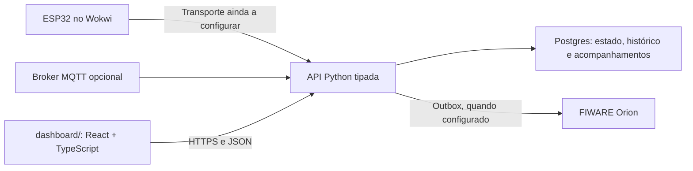

# water n' assurance — backend Python no Linux/WSL

> Vigia d’Água · revisão de 16/11/2026.

O servidor fica em [`backend/`](../backend/README.md), com Python 3.12, FastAPI, Pydantic, SQLAlchemy e Postgres. A interface React/TypeScript fica em [`dashboard/`](../dashboard/README.md), separada na raiz. A decisão e os avisos do dispositivo permanecem no ESP32.

## 1. Arquitetura



Python é a linguagem do servidor. O enunciado de Edge cita backend FIWARE ou IoT Cloud; essa camada precisa ser demonstrada ao fechar a entrega. Node-RED foi uma proposta anterior, não uma exigência escrita confirmada.

## 2. Começar com o Docker já instalado no Ubuntu

No WSL:

```bash
sudo docker info
mkdir -p ~/projetos
cd ~/projetos
git clone https://github.com/BrThiagoN/water-n-assurance.git
cd water-n-assurance/backend
python3 scripts/setup_env.py
sudo docker compose up -d --build --wait backend
curl --fail-with-body http://localhost:8000/healthz
sudo docker compose exec backend python -m scripts.smoke
```

Se já clonou, atualize a pasta existente com `git pull --ff-only`, preservando alterações locais. O gerador não substitui `.env` existente. Ele funciona com o Python do Ubuntu e não exige as bibliotecas da API. Os containers usam Python 3.12.

Mantenha uma sessão Ubuntu aberta ao trabalhar localmente. Se seu usuário tem acesso ao daemon, `sudo` pode ser omitido; `docker -v` sozinho não verifica essa permissão.

## 3. Abrir o dashboard separado

Em outro terminal, com Node.js 24.15+ da linha 24:

```bash
cd water-n-assurance/dashboard
npm ci
npm run dev
```

Abra `http://localhost:5173`. A configuração padrão consulta `http://localhost:8000`. A URL pública da API pode ser definida em `dashboard/.env.local` por `VITE_API_URL`. Não coloque tokens nesse arquivo: variáveis `VITE_` entram no JavaScript público.

O dashboard usa a paleta Merino `#F5EEDD`, Rock Blue `#84B3CE`, Venice Blue `#16587B` e as fontes dos slides: DM Serif Display e Source Sans 3. Valores inválidos ou antigos não são apresentados como leituras atuais. Os acompanhamentos usam a chave administrativa digitada na sessão, sem armazenamento local.

## 4. Tipagem e testes

```bash
cd backend
sudo docker compose --profile test up -d test-db
sudo docker compose --profile test run --rm --build tests
```

Esse comando roda Ruff, `mypy` estrito e testes com Postgres real em banco isolado. No dashboard:

```bash
npm test
npm run build
```

O teste HTTP de demonstração gera dados sintéticos identificados como teste. Não confundir esses registros com uma mensagem realmente produzida pelo ESP32. O [registro de validação](backend-validation.md) diferencia as verificações executadas das integrações pendentes.

## 5. Conectar o Wokwi posteriormente

O firmware atual usa MQTT e ainda aponta para `localhost:1883`. Esse endereço não alcança um servidor do notebook a partir do gateway público do Wokwi.

Há dois caminhos de transporte: configurar um broker alcançável e as credenciais MQTT ou adaptar o firmware para `POST /api/v1/ingest` via HTTPS. Trocar apenas o hostname MQTT por uma URL HTTPS não implementa essa mudança. Preservar filas, retentativas, identificadores e a execução independente da lógica de borda; validar TLS sem desabilitar a verificação do certificado.

O corpo JSON continua em `schema_version: 2`, com `telemetry` ou `event`. O token de ingestão é separado do administrativo. Qualquer segredo escrito em um Wokwi público fica visível; usar somente credenciais restritas de demonstração no ambiente acadêmico, sem credenciais de conta ou de produção.

## 6. FIWARE e Render

Para Orion local, defina `ORION_URL=http://orion:1026` em `backend/.env` e inicie `sudo docker compose --profile fiware up -d --build`. A sincronização NGSI-v2 usa uma outbox persistente; sem Orion disponível, permanece pendente.

O [`render.yaml`](../render.yaml) define a API Python **Free**, Postgres **Free** e o dashboard como Static Site. Ao sincronizar o Blueprint, preserve banco e tokens e confira os endereços usados em `VITE_API_URL` e `ALLOWED_ORIGINS`. Nenhum serviço pago foi autorizado.

O Web Service gratuito suspende por inatividade; o Postgres gratuito expira após 30 dias. A suspensão interrompe coleta em segundo plano. O histórico fica no Postgres, não no filesystem temporário do Render. O Blueprint não cria uma instância FIWARE em nuvem.

## 7. Antes do vídeo de Edge

1. Repetir os cenários do [roteiro do firmware](../firmware/wokwi/TESTES.md).
2. Fazer uma mensagem realmente gerada no Wokwi chegar ao backend e aparecer no dashboard.
3. Demonstrar a camada FIWARE/IoT Cloud escolhida, sem confundir linguagem com plataforma.
4. Mostrar os estados e os avisos locais, inclusive falha e reconhecimento do som.
5. Mostrar o histórico e a distinção entre comunicação antiga e leitura atual.
6. Gravar o vídeo narrado de até sete minutos, identificando simulação, componentes, limites e os quatro integrantes.

## Equipe

| Integrante | RM |
|---|---|
| Thiago Gomes Nascimento | RM569436 |
| Rafael De Sousa | RM568777 |
| Vitor Assis Florenzano | RM572192 |
| Raul Moreira Andrade | RM571042 |

Companhia: **water n' assurance**. Produto: **Vigia d’Água**. Vila Prudente/SP facilita a execução inicial pela proximidade da equipe; o relato familiar de água de poço em Iguatu/CE motivou a ideia, sem causa laboratorialmente confirmada.

Referências: [FastAPI](https://fastapi.tiangolo.com/), [Pydantic](https://docs.pydantic.dev/latest/), [SQLAlchemy](https://docs.sqlalchemy.org/en/20/orm/declarative_tables.html), [Render Python](https://render.com/docs/deploy-fastapi), [Render Free](https://render.com/docs/free), [FIWARE NGSI-v2](https://fiware-orion.readthedocs.io/en/master/orion-api.html).
