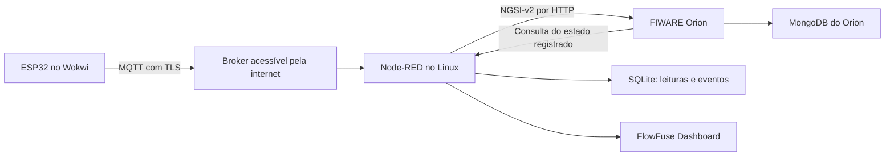

# water n' assurance — backend e integração no Linux

> Produto: **Vigia d’Água** · GS CitizenTech 2026.2 · 1ESPV-2026.
> Preparado em **14/11/2026** para continuar a implementação no Linux.
> Este documento é um plano de implementação. Os serviços, os fluxos e a integração descritos abaixo ainda precisam ser construídos e testados.

## 1. Objetivo desta etapa

Fazer uma leitura e uma alteração percorrerem o caminho **ESP32 no Wokwi → comunicação MQTT → backend → painel**, com registros que possam ser consultados depois.

O ESP32 continua responsável por validar as entradas, filtrar o índice óptico, decidir os estados e acionar OLED, LED e buzzer. O servidor recebe e organiza o que o aparelho decidiu. A falta de conexão não deve interromper a experiência local.

Thiago lembrou que o professor citou **Node-RED** nas aulas. Por isso, a proposta é usá-lo como servidor de integração e como base do painel de Edge. O objetivo do enunciado também menciona **FIWARE ou IoT Cloud**; incluir **FIWARE Orion** é a proposta para seguir a alternativa explicitamente nomeada. A lembrança sobre Node-RED não significa que o professor tenha dispensado essa camada. [A1] [A2]

**Primeiro resultado verificável:** alterar uma entrada no Wokwi, receber o JSON no Node-RED e identificar o mesmo dispositivo, estado e valores na mensagem recebida.

## 2. Ponto de partida no repositório

- Repositório: [BrThiagoN/water-n-assurance](https://github.com/BrThiagoN/water-n-assurance).
- Simulação: [Vigia d’Água no Wokwi](https://wokwi.com/projects/480416382701050881).
- Referência desta revisão: commit [`4438861`](https://github.com/BrThiagoN/water-n-assurance/commit/44388615920890d68deb67e4eb6bde132da8da94), consultado em 14/11/2026. Conferir o estado novo ao retomar; o projeto pode ter avançado.

| Arquivo existente | O que já está preparado |
|---|---|
| `firmware/wokwi/sketch.ino` | Aquisição, interface local, botão de silêncio e preparação dos snapshots. |
| `firmware/wokwi/edge_core.h` | Motor de interpretação e política do alarme. |
| `firmware/wokwi/config.h` | Identificador do dispositivo, Wi-Fi, intervalos e configuração MQTT. |
| `firmware/wokwi/network.cpp` e `network.h` | JSON de telemetria/eventos, filas, retentativas e transporte MQTT em tarefa separada. |
| `firmware/wokwi/self_tests.h` | Testes locais do firmware; os testes dos encoders também estão em `network.cpp`. |

O README registra uma execução anterior com **69 testes aprovados**. Esta revisão leu os arquivos; **não repetiu a simulação nem executou testes de rede**. Esses testes locais não comprovam persistência no backend ou apresentação no painel. [R1]

Na referência consultada, o host ainda é `localhost`, porta `1883`, com usuário e senha vazios e transporte `WiFiClient` sem TLS. Ainda não há backend implementado no repo. [R2]

## 3. Arquitetura proposta



| Componente | Onde começa rodando | Responsabilidade |
|---|---|---|
| ESP32 | Wokwi no navegador | Interpretar e sinalizar localmente. |
| Broker MQTT | Serviço gerenciado na nuvem | Encaminhar mensagens entre os clientes. |
| Node-RED | Computador Linux | Receber, validar o contrato, registrar, integrar e alimentar o painel. |
| Orion + MongoDB | Containers no Linux | Manter a entidade e o contexto atual no FIWARE. |
| SQLite | Arquivo persistente acessado pelo Node-RED | Guardar histórico de mensagens e eventos, incluindo sua identificação. |
| FlowFuse Dashboard | No mesmo Node-RED | Mostrar o ponto monitorado, seus dados e a situação da comunicação. |

**Estado atual e histórico têm funções diferentes.** O MongoDB usado pelo Orion mantém seus dados de contexto; isso não equivale a um histórico de cada amostra. A proposta usa SQLite para essa série e para os eventos. O uso de Orion com MongoDB é documentado pelo FIWARE. [T5]

O computador Linux funciona como servidor enquanto os processos estiverem ligados. Isso permite desenvolver e gravar a demonstração. Acesso ao painel por outras pessoas, com o computador desligado, exige hospedagem posterior; rodar localmente não cria um endereço público.

### Por que usar um broker na nuvem

O gateway público do Wokwi acessa a internet, mas não a rede local do computador. `localhost` dentro do ESP32 é o próprio ESP32. Com o broker remoto, Wokwi e Node-RED fazem conexões de saída para o mesmo destino, e o Node-RED pode permanecer local. [T1]

Um exemplo é **HiveMQ Cloud**. Conferir o plano realmente disponível e sua duração: o guia atual de início rápido usa uma avaliação de 15 dias do plano Starter. Este documento não depende de uma assinatura paga nem presume gratuidade permanente de uma oferta. Outro broker gerenciado com MQTT/TLS e autenticação pode cumprir o mesmo papel. [T6]

## 4. Preparação no Linux

### 4.1. Obter o projeto

Em uma pasta de trabalho escolhida por você:

```bash
git clone https://github.com/BrThiagoN/water-n-assurance.git
cd water-n-assurance
git status --short
git log -1 --oneline
```

Se o repositório já estiver clonado, entrar nele e verificar alterações locais antes de atualizar. Preservar trabalho ainda não commitado.

### 4.2. Ambiente recomendado

Usar **Docker Engine com Compose** para reunir Node-RED, Orion e MongoDB em um ambiente reproduzível. Instalar conforme a distribuição nas [instruções oficiais do Docker para Linux](https://docs.docker.com/engine/install/). Não há pressuposto de Ubuntu, Debian, Fedora ou outra distribuição específica.

Verificar a instalação:

```bash
docker --version
docker compose version
```

O Node-RED pode começar sozinho, antes do Compose completo. Este comando cria uma instância local com dados em volume persistente; usar o nome indicado apenas se ainda não existir um container com ele:

```bash
docker run -d \
  --name water-n-assurance-node-red \
  -p 127.0.0.1:1880:1880 \
  -v water_n_assurance_node_red_data:/data \
  nodered/node-red
```

Abrir `http://127.0.0.1:1880` no Linux. A imagem e o diretório `/data` seguem a orientação oficial. No ambiente definitivo, registrar e fixar as versões ou digests realmente testados. O comando acima é apenas o início do Node-RED, não instala FIWARE nem cria nossos fluxos. [T2]

Para acompanhar essa instância:

```bash
docker logs --tail 80 water-n-assurance-node-red
docker stop water-n-assurance-node-red
docker start water-n-assurance-node-red
```

Ao passar para Compose, planejar o reaproveitamento do volume e parar a instância inicial antes de usar novamente a porta 1880.

## 5. Contrato MQTT que já existe

**Preservar os tópicos atuais**, salvo necessidade técnica comprovada:

```text
water-n-assurance/v1/vigia-sim-01/telemetry
water-n-assurance/v1/vigia-sim-01/events
```

O dispositivo é `vigia-sim-01`. A telemetria é configurada para envio periódico a cada **5 segundos**, com envio adicional em mudanças e reconexões. Eventos seguem uma fila própria. As publicações usam QoS 1. [R2]

O `v1` faz parte do caminho dos tópicos; o payload atual declara `schema_version: 2`. Registrar ambos como estão no firmware, sem mudar um deles apenas para fazê-los parecer iguais.

### Campos importantes

| Campo ou grupo | Como interpretar |
|---|---|
| `schema_version`, `message_kind`, `device_id` | Identificar contrato, tipo de mensagem e dispositivo. |
| `boot_id`, `seq` | Identificar uma observação dentro de uma inicialização. |
| `uptime_ms`, `sent_uptime_ms` | Tempos de operação do ESP32; não são data/hora de calendário. |
| `time_synced: false` | A mensagem não traz um horário UTC confiável da medição. |
| `simulated`, `test_override` | Identificar simulação e entradas substituídas por comandos de teste. |
| `assessment_state`, `reason`, `flow_context` | Estado interpretado, motivo e contexto de circulação. |
| `assessment_available` | Se a avaliação óptica está disponível. |
| `channels` | Qualidade, validade, unidade, origem e idade de cada canal. |
| `optical_index_raw`, `optical_index_filtered` | Índice óptico relativo, sem unidade NTU. O filtrado depende de sua validade. |
| `temperature_c`, `flow_l_min`, `pressure_bar` | Valores válidos de contexto, quando presentes. |
| `event_id`, `event_seq`, `event_sample_seq` | Identificação e vínculo da mensagem de evento com a observação. |
| `event_*` e `event_channels` | Conteúdo histórico do evento, separado dos campos do snapshot atual. |
| `dropped_events` | Contagem de eventos descartados pelo transporte do dispositivo. |

Os eventos têm nomes próprios, como `event_state`, `event_reason` e `event_uptime_ms`; não usar o parser de telemetria sem adaptar esses campos. A lista completa está nos encoders `encodeSnapshot` e `encodeEvent` de `network.cpp`. [R2]

### Regras que o backend deve respeitar

1. Acrescentar **`received_at` em UTC** no primeiro recebimento aceito. Para eventos reenviados, esse horário representa a chegada ao servidor, não o instante original da alteração.
2. Identificar telemetria por **`device_id + boot_id + seq`** e eventos por **`event_id`**. QoS 1 admite reentregas; usar chaves únicas para evitar registros duplicados.
3. Preservar o JSON original para investigação e exportação. Manter campos derivados separados.
4. Usar snapshots de telemetria para atualizar o estado atual. Eventos antigos recebidos após uma reconexão alimentam o histórico e não devem substituir esse estado.
5. Considerar sequências dentro do respectivo `boot_id`; uma reinicialização começa outra sequência. Reconhecer também mensagens antigas ou repetidas ao atualizar a entidade atual.
6. Respeitar a validade por canal. Uma falha de temperatura pode coexistir com uma avaliação óptica disponível; `readings_valid: false` não significa automaticamente que tudo ficou indisponível.
7. Tratar campos ausentes como ausência de valor válido naquele snapshot. Um número antigo não pode continuar aparecendo como leitura atual após uma falha.
8. Conservar o estado calculado pelo ESP32. O backend não deve refazer a classificação com limites diferentes.

**Limite offline atual:** snapshots guardam apenas a versão mais recente. A fila comporta 16 eventos aguardando e até um em envio; é mantida em RAM, pode descartar eventos e se perde ao reiniciar. Não prometer recuperação de todas as amostras ou de todo o histórico de uma desconexão. Uma confirmação MQTT também não prova que SQLite, Orion ou painel já receberam o dado. [R2]

## 6. Fluxos a construir no Node-RED

### Fluxo A — entrada e validação

```text
MQTT In → JSON, se necessário → validação → separação telemetry/events
```

Usar dois nós `MQTT In` para os tópicos exatos do dispositivo, ou um filtro com validação do tópico recebido. Configurar o mesmo broker, com identificadores de cliente diferentes dos usados pelo ESP32. O nó MQTT suporta inscrição em tópicos e entrega o tópico em `msg.topic`. [T3]

Conferir tipo de mensagem, versão, dispositivo, campos obrigatórios e coerência entre tópico e payload. Mensagens inválidas devem gerar diagnóstico visível e não atualizar o painel como se fossem válidas.

### Fluxo B — persistência

Proposta de tabelas SQLite:

| Tabela | Chave | Conteúdo principal |
|---|---|---|
| `telemetry` | `device_id`, `boot_id`, `seq` | Horário de recebimento, estado, disponibilidade e JSON original. |
| `events` | `event_id` | Dispositivo, boot, sequência do evento, sequência da amostra, horário de chegada e JSON original. |

Usar restrições de unicidade, consultas parametrizadas e um arquivo em volume persistente. O nó SQLite pode ser adicionado pela paleta; conferir a dependência e sua compatibilidade com a imagem antes de fixar o ambiente. Ver [node-red-node-sqlite](https://flows.nodered.org/node/node-red-node-sqlite).

O contexto padrão do Node-RED fica em memória. Mesmo o contexto em arquivo tem política de gravação própria; ele pode ajudar no estado de execução, mas não substitui automaticamente esse histórico estruturado. [T4]

### Fluxo C — integração FIWARE

Usar Node-RED como adaptador entre o JSON do firmware e **NGSI-v2**. Esta proposta não exige acrescentar IoT Agent: o Node-RED recebe MQTT e faz as requisições HTTP ao Orion.

Entidade proposta:

```text
id: urn:ngsi-ld:WaterMonitor:vigia-sim-01
type: WaterMonitor
Fiware-Service: waternassurance
Fiware-ServicePath: /
```

O prefixo do identificador acima é uma convenção; a API escolhida continua sendo NGSI-v2.

Mapeamento inicial:

| Atributo | Tipo NGSI-v2 | Origem |
|---|---|---|
| `deviceId` | `Text` | `device_id`. |
| `assessmentState` | `Text` | `assessment_state`. |
| `assessmentAvailable` | `Boolean` | `assessment_available`. |
| `receivedAt` | `DateTime` | Horário atribuído pelo servidor. |
| `lastSnapshot` | `StructuredValue` | Snapshot completo validado, com seus canais e sinalizadores. |

Criar a entidade no primeiro recebimento e atualizar seus atributos nos seguintes. Substituir o objeto `lastSnapshot` inteiro, para que a ausência de um valor inválido não deixe números de snapshots anteriores misturados aos atuais. Tratar respostas de sucesso e falha do Orion e mostrar a situação da integração no painel.

Na rede Compose, o Node-RED deve usar o nome do serviço, por exemplo `http://orion:1026`. De dentro do container, `localhost` aponta para o próprio container. Publicar a porta 1026 apenas na interface local para inspeção pelo computador; o MongoDB não precisa de porta pública.

Após configurar Orion e criar a entidade, exemplos de inspeção no Linux:

```bash
curl --fail-with-body http://127.0.0.1:1026/version

curl --fail-with-body \
  -H 'Fiware-Service: waternassurance' \
  -H 'Fiware-ServicePath: /' \
  'http://127.0.0.1:1026/v2/entities/urn:ngsi-ld:WaterMonitor:vigia-sim-01?options=keyValues'
```

Esses comandos pressupõem serviço configurado, porta publicada e entidade existente. **Evidência de integração:** consultar no Orion o estado que acabou de ser recebido do Wokwi; o painel deve indicar a última atualização confirmada no FIWARE. [T5]

### Fluxo D — painel de Edge

Instalar **`@flowfuse/node-red-dashboard`** pela paleta. É o Dashboard 2.0 mantido; o pacote antigo `node-red-dashboard` foi descontinuado. O pacote pode rodar em uma instalação própria do Node-RED, sem conta de hospedagem FlowFuse. [T7]

Painel inicial proposto:

- Companhia **water n' assurance**, produto **Vigia d’Água** e ponto `vigia-sim-01`.
- Estado recebido: **Sem alteração detectada**, **Atenção**, **Verifique** ou **Leitura indisponível**.
- Temperatura, índice óptico, vazão e pressão, com unidade e validade por canal.
- Gráfico do índice óptico bruto e filtrado, respeitando disponibilidade.
- Tabela de eventos e consulta ao histórico persistido.
- Última mensagem recebida e indicação separada da comunicação e da integração FIWARE.
- Identificação de que os dados são simulados.

Proposta técnica para a demonstração: após **20 segundos sem telemetria nova**, indicar **“Sem comunicação — última leitura recebida às…”**. Esse tempo precisa ser testado e ajustado; não tem significado sanitário. A ausência de comunicação não altera retroativamente o último estado decidido pelo aparelho. Eventos antigos e mensagens repetidas não devem renovar a indicação de uma leitura atual.

O snapshot atual não transmite `alarm_latched`, `muted` nem `buzzer_on`. Portanto, o painel inicial não deve afirmar que o som está ligado, silenciado ou reconhecido. Se isso entrar no escopo, acrescentar esses campos e os respectivos eventos ao contrato e testar a mudança.

## 7. Ajustes necessários no firmware

| Onde | Ajuste |
|---|---|
| `config.h` | Host e porta reais do broker, configuração de autenticação e parâmetros do ambiente. |
| `network.cpp` | Adaptar o transporte para MQTT com TLS e validação do certificado do servidor. Alterar só a porta para 8883 não torna `WiFiClient` seguro. |
| Camada de rede | Preservar a separação da aquisição, as retentativas, filas e identificadores. Retestar o comportamento diante da nova conexão. |
| `sketch.ino` | Completar a identificação do time, incluindo Raul, se isso ainda não tiver sido corrigido na versão nova. |

A configuração e o mecanismo de validação de certificados dependem do broker e do core ESP32 escolhidos; precisam ser implementados e testados, inclusive com o relógio necessário à verificação de validade. Não usar uma conexão sem verificação do certificado como solução definitiva.

Credenciais da conta do broker não pertencem ao código público. Planejar credenciais restritas ao dispositivo de demonstração, separadas das credenciais do servidor; um segredo escrito em um projeto Wokwi público fica visível. O arquivo `.env` do Linux não é automaticamente carregado pelo Wokwi.

## 8. Organização sugerida no repo

**A estrutura abaixo é proposta; seus arquivos ainda precisam ser criados.**

```text
water-n-assurance/
├── firmware/wokwi/                 # já existe
├── backend/
│   ├── compose.yaml                # Node-RED, Orion e MongoDB
│   ├── .env.example                # nomes de variáveis, sem credenciais
│   ├── README.md                   # iniciar, configurar, verificar e parar
│   └── node-red/
│       ├── Dockerfile              # imagem e dependências testadas
│       ├── package.json
│       ├── package-lock.json
│       ├── settings.js
│       └── flows.json              # exportação sem credenciais
├── docs/
│   ├── gsBackendLinux.md
│   └── evidencias-edge.md
└── README.md
```

Usar volumes para os dados do Node-RED, MongoDB e SQLite. O Compose deverá declarar o ambiente recebido pelos processos; apenas criar `.env` não configura todos os nós. Documentar variáveis como `MQTT_HOST`, `MQTT_PORT`, `MQTT_USERNAME`, `MQTT_PASSWORD`, `ORION_URL` e o caminho do SQLite.

Exportar os fluxos e fixar as dependências, para que outro integrante consiga recriar o ambiente. Manter `.env`, credenciais, bancos de execução e chaves fora do versionamento. Este guia está em `docs/gsBackendLinux.md`. As demais pastas e os serviços propostos deverão ser criados ao continuar no Linux.

## 9. Ordem de implementação e critérios de avanço

| Etapa | Fazer | Considerar pronta quando |
|---|---|---|
| **1. Comunicação** | Configurar broker, adaptar firmware e assinar os dois tópicos no Node-RED. | Uma mensagem produzida pelo Wokwi chega e é identificada corretamente no Debug. |
| **2. Contrato e histórico** | Validar, separar tipos, registrar em SQLite e reconhecer duplicatas. | Telemetria e eventos persistem; repetir o mesmo evento não duplica a ocorrência. |
| **3. FIWARE** | Subir Orion/MongoDB e implementar o adaptador NGSI-v2. | A consulta à entidade retorna o snapshot recém-recebido. |
| **4. Painel** | Apresentar estado, canais, gráfico, eventos e comunicação. | A mudança realizada no Wokwi aparece e uma falha não mantém um valor antigo como atual. |
| **5. Falhas e retorno** | Desligar/religar rede, reiniciar serviços e exercitar entradas inválidas. | A decisão local continua; histórico e indicadores refletem o que realmente ocorreu. |
| **6. Reprodução** | Fixar ambiente, exportar fluxos e documentar os cenários. | Outro integrante consegue iniciar e repetir a demonstração seguindo o README. |
| **7. Vídeo** | Ensaiar e gravar com as evidências prontas. | O vídeo mostra circuito, lógica, estados, integração e limites dentro do tempo. |

O primeiro marco deve usar uma mensagem real do Wokwi. Mensagens fictícias injetadas no Node-RED ajudam a testar o backend, mas não demonstram a integração completa.

## 10. Verificações antes de gravar

Registrar data, versões, cenário, resultado observado e evidência. Não marcar itens como concluídos por este documento existir.

- [ ] Receber telemetria e evento reais do Wokwi.
- [ ] Conferir dispositivo, unidades, dados simulados e validade por canal.
- [ ] Consultar no Orion a entidade atualizada.
- [ ] Consultar o registro persistido no SQLite.
- [ ] Reenviar um mesmo evento e confirmar ausência de duplicação.
- [ ] Receber evento antigo após um snapshot novo sem regredir o estado atual.
- [ ] Reiniciar Node-RED e confirmar que o histórico permanece acessível.
- [ ] Observar **Sem alteração detectada**, **Atenção**, **Verifique** e **Leitura indisponível**.
- [ ] Provocar falha de canal e verificar que seu valor antigo não aparece como atual.
- [ ] Usar `TEST NET OFF` e comprovar que a aquisição e o aviso local continuam.
- [ ] Conferir que o painel passa a indicar falta de comunicação, preservando o horário da última leitura.
- [ ] Usar `TEST NET ON` e conferir reconexão, snapshot recente e tratamento dos eventos da fila.
- [ ] Exercitar o botão físico de silêncio/reativação no Wokwi, sem atribuir ao painel estados de som que ele não recebe.
- [ ] Comparar `event_id`, `boot_id`, sequência e horários nos registros para explicar o caminho da informação.
- [ ] Retestar as partes do firmware afetadas pela alteração da rede e registrar o resultado real.

O [roteiro de testes do firmware](../firmware/wokwi/TESTES.md) documenta a preparação e os cenários locais. Novas execuções precisam registrar seus próprios resultados; a publicação do roteiro não representa uma execução nova.

## 11. O que mostrar no vídeo de Edge

O limite registrado no enunciado é **sete minutos**. A demonstração de integração entra junto da explicação de cidadão, problema, circuito, lógica e estados; não substitui os demais itens da avaliação. [A1]

Sequência sugerida para o trecho de integração:

1. Mostrar Wokwi e painel com o mesmo ponto monitorado.
2. Alterar o índice óptico e explicar a confirmação local, sem chamar o índice de NTU ou de análise de potabilidade.
3. Mostrar a mensagem recebida e o novo estado registrado no FIWARE/painel.
4. Abrir o evento salvo, identificando horário de recebimento e dados da ocorrência.
5. Desligar a comunicação e mostrar que o aparelho continua decidindo e sinalizando.
6. Mostrar a indicação de falta de atualização no painel e, ao reconectar, o retorno do snapshot atual.

Preparar as telas e deixar os serviços iniciados antes do ensaio. Usar apenas comportamentos executados, mantendo separados os resultados funcionais e os planos futuros. O videopitch de Storytelling tem outra finalidade e outro limite de tempo.

## 12. Relação com a aplicação web posterior

O painel Node-RED atende à demonstração de Edge. A aplicação de **Front-end/Web** continua tendo seus próprios requisitos de React, Tailwind, componentes, hooks e CRUD por API externa. Esse painel não substitui automaticamente essa entrega. [A1]

Depois da integração, definir uma API para consultas de estado, histórico e eventos e para o **CRUD de acompanhamentos**. Essa API pode ser implementada a partir do backend escolhido; sua persistência e seus contratos precisam ser definidos. Leituras e eventos originais ficam preservados; o CRUD é para as providências registradas pelo morador.

## 13. Equipe e contexto que precisam acompanhar a implementação

| Integrante | RM |
|---|---|
| Thiago Gomes Nascimento | RM569436 |
| Rafael De Sousa | RM568777 |
| Vitor Assis Florenzano | RM572192 |
| Raul Moreira Andrade | RM571042 |

- **water n' assurance** é a companhia; **Vigia d’Água** é o produto.
- **Vila Prudente, São Paulo — SP** é o recorte operacional do MVP pela proximidade da equipe.
- O caso familiar de água de poço em **Iguatu — CE** motivou a proposta; não há confirmação laboratorial da causa das alterações relatadas.
- O aparelho acompanha alterações em parâmetros limitados. Não filtra a água nem comprova potabilidade.
- Este guia foi preparado com apoio do Codex. Registrar na documentação as implementações efetivamente assistidas por IA e como a equipe as verificou.

## 14. Fontes e limites desta revisão

### Projeto e entrega

- **[A1]** Enunciado geral FIAP CitizenTech 2026.2, seção de Edge Computing (páginas 35–38 do arquivo), fornecido à equipe no [SharePoint da FIAP](https://fiapcom-my.sharepoint.com/personal/pf1740_fiap_com_br/_layouts/15/onedrive.aspx?id=%2Fpersonal%2Fpf1740%5Ffiap%5Fcom%5Fbr%2FDocuments%2FDesafio%2DFIAP%2DGS%2DCitizenTech%201ES%20Paulista%20e%20Lins%2Epdf). A fonte pode solicitar a conta acadêmica. Requisitos registrados na leitura de 10/11/2026; esta etapa não refez uma leitura autenticada da tarefa.
- **[A2]** Decisão informada por Thiago em 14/11/2026: continuar a implementação no Linux; lembrança de que o professor citou Node-RED.
- **[R1]** [README do projeto no commit revisado](https://github.com/BrThiagoN/water-n-assurance/blob/44388615920890d68deb67e4eb6bde132da8da94/README.md).
- **[R2]** [Firmware no commit revisado](https://github.com/BrThiagoN/water-n-assurance/tree/44388615920890d68deb67e4eb6bde132da8da94/firmware/wokwi), principalmente `config.h`, `network.h`, `network.cpp` e `sketch.ino`.

### Documentação técnica consultada em 14/11/2026

- **[T1]** [Wokwi: rede Wi-Fi do ESP32 e gateways](https://docs.wokwi.com/guides/esp32-wifi).
- **[T2]** [Node-RED: execução em Docker](https://nodered.org/docs/getting-started/docker).
- **[T3]** [Node-RED: inscrição em tópico MQTT](https://cookbook.nodered.org/mqtt/subscribe-to-topic).
- **[T4]** [Node-RED: contexto e armazenamento](https://nodered.org/docs/user-guide/context).
- **[T5]** [FIWARE: introdução ao Orion e NGSI-v2](https://fiware-tutorials.readthedocs.io/en/latest/getting-started.html).
- **[T6]** [HiveMQ Cloud: início rápido e plano usado no tutorial](https://docs.hivemq.com/hivemq-cloud/quick-start-guide.html).
- **[T7]** [FlowFuse Dashboard: instalação e primeiros passos](https://dashboard.flowfuse.com/getting-started.html).

Arquitetura, tabelas SQLite, entidade FIWARE, limite de ausência de comunicação e organização de pastas são **propostas de implementação da equipe**, não exigências adicionais atribuídas ao professor. Os comandos de infraestrutura e os fluxos ainda não foram executados neste ambiente Linux.

