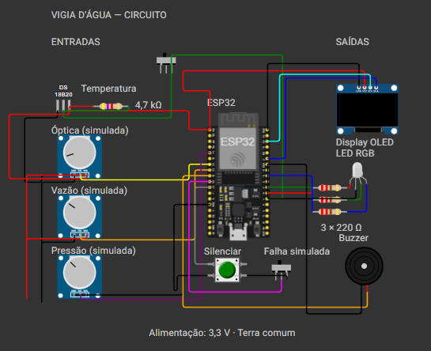

# Vigia d’Água — protótipo ESP32 no Wokwi

Este diretório espelha os arquivos do [protótipo público no Wokwi](https://wokwi.com/projects/480416382701050881), com transporte HTTPS para a API Python. Ele reúne o código, o diagrama, as dependências e uma captura do circuito.

## Equipe

| Integrante | RM |
|---|---|
| Thiago Gomes Nascimento | RM569436 |
| Rafael De Sousa | RM568777 |
| Vitor Assis Florenzano | RM572192 |
| Raul Moreira Andrade | RM571042 |

A identificação dos quatro integrantes consta no cabeçalho de `sketch.ino` e na mensagem de inicialização do Serial Monitor, inclusive no Wokwi público. Atualizada em 16/11/2026, sem alteração das regras de borda.

## Circuito no Wokwi



## O que o dispositivo simula

Um ESP32 recebe valores simulados, valida as leituras, suaviza o índice óptico e decide localmente se há uma mudança para acompanhar. O display OLED, o LED RGB e o buzzer mostram a resposta sem depender de servidor.

| Componente no diagrama | Pino | Função nesta revisão |
|---|---:|---|
| DS18B20 | GPIO 4 | Temperatura em °C, como contexto da leitura. |
| Potenciômetro “Óptica” | GPIO 32 | Índice óptico relativo de 0 a 100; é a entrada usada para classificar mudanças. Não é NTU. |
| Potenciômetro “Vazão” | GPIO 33 | Entrada simulada em L/min; indica se há circulação e se a avaliação pode avançar. |
| Potenciômetro “Pressão” | GPIO 34 | Entrada simulada em bar, registrada como contexto. Não estima nível da caixa nem classifica potabilidade. |
| OLED SSD1306 | I²C: SDA 21, SCL 22 | Mensagem textual, estado, disponibilidade e instrução do botão. |
| LED RGB | GPIO 16, 17 e 18 | Indicação visual associada ao estado, junto com palavra e símbolo. |
| Buzzer piezo | GPIO 25 | Alarme sonoro contínuo para uma alteração confirmada. |
| Botão “Silenciar” | GPIO 27 | Reconhece e silencia; outro clique reativa o som se a mesma condição continuar confirmada. |
| Chave “Falha simulada” | GPIO 26 | Exercita o tratamento local de uma falha de entrada. |

Os três potenciômetros e a chave de falha são controles do simulador, não sondas físicas. As unidades de vazão e pressão são valores de cenário; não há calibração de sensores reais.

## Interpretação local

O ESP32 mantém quatro resultados compreensíveis: **Sem alteração detectada**, **Atenção**, **Verifique** e **Leitura indisponível**. O índice óptico passa por uma mediana de cinco amostras. Os limites didáticos da revisão atual são 30 e 60 para subida e 25 e 55 para retorno, com confirmações novas apoiadas pelo valor bruto e pelo filtrado. Eles servem para demonstrar persistência e histerese, não são limites sanitários.

Leitura inválida, ausente ou antiga não vira normalidade. Temperatura e pressão dão contexto; falhas nesses canais são informadas sem apagar automaticamente uma avaliação óptica ainda válida. A classificação óptica depende de sinal óptico e circulação utilizáveis.

Quando Atenção ou Verifique é confirmado, o buzzer permanece ligado até reconhecimento. O primeiro clique silencia. Se a condição ainda estiver confirmada, o próximo clique liga o buzzer novamente. Se a leitura já normalizou, o clique prepara os avisos seguintes; não ressuscita um alarme antigo. Uma nova ocorrência ou escalada rearma o alarme.

## 1. Executar o projeto pronto

Você precisa de um navegador com internet. Para experimentar a simulação pronta, não precisa de placa física, Arduino IDE, Node.js ou Docker.

1. Abra o [projeto público no Wokwi](https://wokwi.com/projects/480416382701050881).
2. Inicie a simulação pelo botão de reprodução e espere a compilação.
3. Confira o **Serial Monitor**, que recebe as mensagens de inicialização e os autotestes.
4. Procure a linha `[TEST] SUMMARY passed=69 failed=0 result=PASS`, referência da revisão 3. Se o resumo indicar falha, interrompa os experimentos e examine as linhas `FAIL`.
5. Use a preparação abaixo para obter uma condição inicial conhecida.

O teste local funciona com a rede em `OFF` e sem credencial. A decisão, o display e o alarme não dependem da API.

### Enviar leituras ao dashboard do Render

1. Abra o [dashboard publicado](https://water-n-assurance-dashboard.onrender.com/). A primeira consulta pode demorar enquanto o serviço gratuito da API inicia.
2. Inicie o Wokwi e confira os autotestes. O destino em `config.h` é `https://water-n-assurance.onrender.com/api/v1/ingest`.
3. Na conta do Render da equipe, abra o serviço da API → **Environment** e copie o valor de `INGEST_TOKEN`. Não use `ADMIN_TOKEN`.
4. No **campo de entrada do Serial Monitor**, envie `NET TOKEN <valor copiado>` e pressione Enter. Substitua o marcador pela chave, sem os sinais `< >`. Em seguida envie `TEST NET ON` se a rede foi desligada durante um teste.
5. Aguarde Wi-Fi, sincronização de relógio e a confirmação `[NET] HTTPS 201: persistencia confirmada pelo backend Python.` Uma repetição idempotente pode retornar 200.
6. O dashboard consulta a API a cada dez segundos. Confira o ponto `vigia-sim-01`, o horário de recebimento e o estado. Para um cenário controlado, envie `TEST FLOW 6` e `TEST OPTICAL 40`; depois da confirmação local, o painel deve mostrar **Atenção**.

A chave fica somente na RAM da sessão e não é impressa pelo firmware. **Não cole a chave no código, no GitHub, em capturas ou no vídeo.** Parar/reiniciar a simulação apaga a chave; é necessário digitá-la novamente. `NET CLEAR` também a apaga. `RESET` reinicia apenas o contexto da medição e preserva a credencial da sessão.

O envio usa HTTPS com verificação do certificado pelo bundle público WE1 + GTS Root R4 em `https_ca.h`; o relógio é sincronizado para validar TLS. O `time_synced: false` do contrato continua indicando que não há timestamp UTC da medição. O servidor registra seu próprio horário de recebimento. A intermediária WE1 foi conferida contra uma conexão TLS validada do serviço em 17/11/2026; usá-la como âncora evita uma verificação P-384 lenta no simulador. GTS Root R4 permanece como alternativa. Uma troca de cadeia ou vencimento exige conferir e atualizar o bundle, mantendo a validação de hostname e certificado. As filas e retentativas ficam numa tarefa separada; a confirmação de envio exige a resposta de aceitação da API após a transação no Postgres.

## 2. Preparar uma condição inicial conhecida

No **campo de entrada do Serial Monitor do Wokwi**, envie uma linha por vez, pressionando Enter após cada uma:

```text
RESET
TEST NET OFF
TEST FLOW 6
TEST OPTICAL 20
```

Deixe a chave **Falha simulada** na posição sem falha. Aguarde aproximadamente 15 segundos no relógio da simulação; então envie:

```text
STATUS
```

Conferência:

| Onde olhar | Resultado esperado |
|---|---|
| OLED | “Sem alteração detectada”, após inicialização e estabilização. |
| LED RGB | Verde. |
| Serial | `"state":"NO_CHANGE"` e `"assessment_available":true`. |
| Rede | `"network":"OFFLINE"`, esperado nesta preparação. |
| Modo de entrada | `"test_override":true`, pois foram fixados óptica e vazão por comandos. |

O firmware mede normalmente a cada segundo simulado. Ao iniciar ou recuperar uma avaliação, ele confirma circulação, renova a amostra, reúne cinco valores para o filtro e confirma o estado. Por isso, “Leitura indisponível” durante essa preparação é esperada.

`RESET` limpa o contexto lógico, os overrides e o reconhecimento do alarme; ele não reinicia a placa nem o relógio de operação. Também volta a habilitar a rede conforme `config.h`, por isso o roteiro envia `TEST NET OFF` em seguida.

Os comandos `TEST OPTICAL` e `TEST FLOW` substituem temporariamente os respectivos potenciômetros. Enquanto o override estiver ativo, girar o controle físico correspondente não muda a entrada. Para devolver o controle:

```text
TEST OPTICAL OFF
TEST FLOW OFF
```

Para continuar os experimentos, use o [roteiro de estados e falhas](TESTES.md).

## 3. Recriar o projeto com os arquivos do GitHub

Este caminho permite usar sua própria cópia e conferir exatamente o conteúdo versionado no repo.

### 3.1. Obter os arquivos

No Linux, com Git instalado:

```bash
git clone https://github.com/BrThiagoN/water-n-assurance.git
cd water-n-assurance
git log -1 --oneline
ls firmware/wokwi
```

Também é possível baixar o ZIP pelo menu **Code → Download ZIP** do GitHub e extrair a pasta. O objetivo é obter os arquivos de `firmware/wokwi/`.

### 3.2. Criar uma cópia no Wokwi

A forma mais curta é abrir o [projeto existente](https://wokwi.com/projects/480416382701050881), entrar na sua conta e salvar uma cópia. Ela já contém as abas do código e o circuito.

Para começar com um projeto vazio, abra o [template Arduino ESP32](https://wokwi.com/projects/new/esp32). Substitua `sketch.ino` e `diagram.json` pelos arquivos do repo e crie os arquivos adicionais no editor, mantendo seus nomes exatos.

Em qualquer um dos caminhos, substitua o conteúdo das abas pelos **nove arquivos da mesma revisão do GitHub**:

| Arquivo | Conteúdo que deve ser copiado |
|---|---|
| [sketch.ino](sketch.ino) | Aquisição, interface e ciclo principal. |
| [config.h](config.h) | Pinos, intervalos e configuração. |
| [edge_core.h](edge_core.h) | Validação, filtro, estados e alarme. |
| [self_tests.h](self_tests.h) | Autotestes do motor. |
| [network.h](network.h) | Contrato da camada de rede. |
| [network.cpp](network.cpp) | Encoders, filas, HTTPS e retentativas. |
| [https_ca.h](https_ca.h) | CA pública para verificar o certificado HTTPS; não contém credenciais. |
| [diagram.json](diagram.json) | Diagrama e ligações do circuito. |
| [libraries.txt](libraries.txt) | Dependências do projeto. |

Para copiar um arquivo pelo GitHub, abra o arquivo e use **Raw** para obter apenas seu conteúdo. Copie o arquivo inteiro, sem os delimitadores de blocos Markdown, e substitua o conteúdo da aba correspondente no Wokwi.

Os arquivos devem ficar no mesmo projeto, com as extensões corretas. Não criar abas para este README, `TESTES.md` ou a imagem em `assets/`; eles são documentação.

### 3.3. Conferir as bibliotecas

O arquivo `libraries.txt` do repo lista:

```text
OneWire
DallasTemperature
U8g2
ArduinoJson
```

Confira se essas bibliotecas aparecem no **Library Manager**. É possível adicioná-las pela busca do gerenciador; ele cria/atualiza `libraries.txt`. A simulação web usa esse arquivo para resolver as dependências. [Bibliotecas no Wokwi](https://docs.wokwi.com/guides/libraries).

As versões dessas quatro bibliotecas ainda não estão fixadas no arquivo. HTTPClient e WiFiClientSecure pertencem ao core ESP32. Para uma reprodução com versões exatas, registrar o core e as versões que compilarem e passarem nos testes antes de fixá-las. Não há uma configuração pronta de Arduino CLI ou PlatformIO neste repo.

### 3.4. Salvar, iniciar e conferir

1. Salve a sua cópia.
2. Inicie a simulação e confira que o circuito foi carregado de `diagram.json`.
3. Procure o resumo dos autotestes no Serial Monitor.
4. Execute a preparação da seção 2.
5. Repita os quatro estados no [roteiro de testes](TESTES.md).
6. Guarde o link da sua cópia e o commit do GitHub usado na reprodução.

Se apenas o código de uma aba for atualizado, outras abas antigas podem deixar o projeto incompatível. Use os nove arquivos da mesma revisão.

## 4. Como usar os controles do circuito

| Controle | Como experimentar | O que ele representa |
|---|---|---|
| Potenciômetro “Óptica” | Envie `TEST OPTICAL OFF` e ajuste o controle no simulador. | Índice relativo de 0 a 100. |
| Potenciômetro “Vazão” | Envie `TEST FLOW OFF` e ajuste o controle. | Vazão de cenário entre 0 e 20 L/min. |
| Potenciômetro “Pressão” | Ajuste o controle no simulador. | Pressão de cenário entre 0 e 6 bar. |
| DS18B20 | Clique no sensor durante a execução e use o ajuste de temperatura. | Temperatura simulada em °C. |
| Chave “Falha simulada” | Alterne e observe a disponibilidade da óptica. | Falha técnica da entrada. |
| Botão “Silenciar” | Clique após confirmar Atenção ou Verifique. | Reconhecimento do aviso; outro clique reativa enquanto a condição continuar confirmada. |

O ajuste interativo do DS18B20 é descrito na [referência do sensor](https://docs.wokwi.com/parts/wokwi-ds18b20). Use `STATUS` para conferir os valores após mexer nos controles.

## 5. Comandos do Serial Monitor

Enviar cada linha com Enter. O firmware aceita letras maiúsculas ou minúsculas.

| Comando | Efeito |
|---|---|
| `HELP` | Mostra a lista de comandos. |
| `STATUS` | Imprime o estado, qualidade dos canais, contexto e situação do alarme/rede. |
| `MUTE` | Silencia e reconhece o aviso; não reativa o som. |
| `RESET` | Limpa o contexto lógico e os modos de teste, preservando o boot e o tempo de operação. |
| `TEST OPTICAL 40` / `TEST OPTICAL OFF` | Fixa o índice óptico / devolve ao potenciômetro. |
| `TEST FLOW 6` / `TEST FLOW OFF` | Fixa a vazão / devolve ao potenciômetro. |
| `TEST FAULT OPTICAL ON` / `OFF` | Liga/desliga a falha óptica por comando. Repetir o comando inteiro ao desligar. |
| `TEST FAULT TEMP ON` / `OFF` | Liga/desliga a falha de temperatura; também existem `FLOW` e `PRESSURE`. |
| `TEST STALE ON` / `OFF` | Interrompe/retoma a atualização do lote de leituras. |
| `TEST PULSE 100 1` | Injeta o índice 100 por uma amostra. |
| `TEST NET OFF` / `TEST NET ON` | Desabilita/habilita tentativas de comunicação, mantendo a lógica local. |
| `NET TOKEN <chave>` / `NET CLEAR` | Carrega/apaga a credencial de ingestão somente na sessão. A chave diferencia maiúsculas e minúsculas. |

`TEST FAULT ON` e `TEST FAULT OFF` são atalhos para a falha óptica. Desligar uma falha por comando não corrige uma chave física que continue na posição de falha.

No JSON de `STATUS`, o estado aparece como `state`. No payload HTTPS de telemetria, o campo correspondente é `assessment_state`; são saídas diferentes. Consulte `network.cpp` para o contrato de transporte.

## 6. Solução de problemas

| Situação | O que conferir |
|---|---|
| Erro “arquivo não encontrado” ou referência indefinida | Confira os nove arquivos, nomes e extensões; `network.cpp` e `https_ca.h` também precisam estar no projeto. |
| Erro de biblioteca | Confira `libraries.txt` e o Library Manager; copie o nome exato da dependência. |
| Resumo com `FAIL` ou OLED “Falha nos testes” | Localize a primeira linha `FAIL`, registre o erro e confira se todos os arquivos vieram da mesma revisão. |
| Serial Monitor sem comandos | Inicie a simulação, foque a entrada do monitor e envie a linha com Enter. `HELP` deve receber resposta. |
| “Leitura indisponível” logo após iniciar | Aguarde circulação, renovação, filtro e confirmações. A preparação da seção 2 fixa valores conhecidos. |
| “Falha na óptica” persiste | Desative a falha por comando e confira a posição da chave física. |
| “Sem circulação” | Confira a vazão; `TEST FLOW 6` é a referência deste roteiro. |
| Potenciômetro parece não responder | Desative seu override com `TEST OPTICAL OFF` ou `TEST FLOW OFF`. |
| Normalizou, mas o buzzer continua | Reconheça o aviso pendente com o botão Silenciar ou `MUTE`. A normalização não reconhece o alarme. |
| Som silenciado, mas LED continua amarelo/vermelho | Esse comportamento é esperado: reconhecer o som não muda a condição medida. |
| `OFFLINE` sem dados no painel | Confira `NET TOKEN`, `TEST NET ON`, Wi-Fi e as mensagens `[NET]`. Reiniciar a simulação apaga a chave. |
| HTTPS 401 | Recarregue o `INGEST_TOKEN` do mesmo serviço Render, preservando a capitalização. |
| HTTPS 400/422 | Confira se todos os arquivos são da mesma revisão e se o dispositivo é autorizado na API. |
| Erro TLS ou conexão encerrada | Confira relógio, CA, internet e velocidade da simulação. O firmware tenta novamente sem interromper a decisão local. |
| Painel indica comunicação antiga | O servidor não recebeu uma leitura recente. Não confundir o último estado recebido com uma medição atual. |
| Copiou o projeto, mas perdeu os ajustes | Entre na sua conta e salve a cópia; registre o link usado. |

## 7. Backend no Linux e limites da reprodução

O [guia do backend](../../backend/README.md) explica a API Python tipada e o histórico Postgres, com Docker Compose para Linux/WSL e Blueprint do Render. A interface fica separada em [`dashboard/`](../../dashboard/README.md). MQTT e FIWARE são integrações adicionais que exigem seus próprios servidores; o estado informado pela API distingue essas configurações.

A reprodução descrita neste arquivo é da **simulação**. Os potenciômetros não são sondas de água; o protótipo não foi calibrado com instrumentos físicos, não comprova potabilidade e não substitui análise laboratorial.

O diagrama usa `cpuFrequency: "max"` para concluir TLS antes de o servidor encerrar a negociação. O relógio da simulação pode avançar mais devagar que o tempo real; os intervalos do motor continuam baseados em `millis()`. O OLED transmite somente quando seu bitmap muda, mantendo a atualização do estado, LED e som; isso reduz o custo da emulação durante TLS.

O Wokwi público é a simulação principal; este diretório é o espelho versionado. A versão HTTPS foi compilada em 17/11/2026 e passou em 69 autotestes; a ingestão no Render foi confirmada com mensagens produzidas nessa simulação. Veja o [registro da integração](../../docs/backend-validation.md). Para registrar uma reprodução real, siga a seção final de [TESTES.md](TESTES.md).

## 8. Entrega acadêmica

O enunciado de Edge pede o Wokwi público e um vídeo de equipe de até sete minutos mostrando ideia, circuito, lógica e estados. O vídeo ainda será produzido. Os links de entrega e os nomes/RMs devem seguir a tarefa da disciplina; publicar documentação no GitHub não substitui a entrega no Teams.

[Voltar ao README principal](../../README.md)
